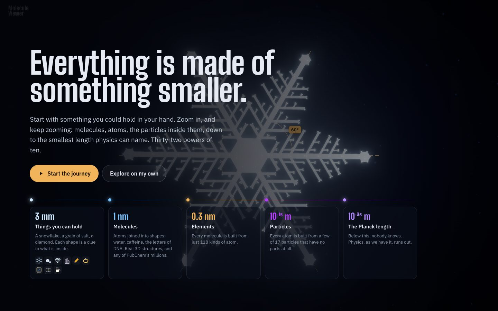
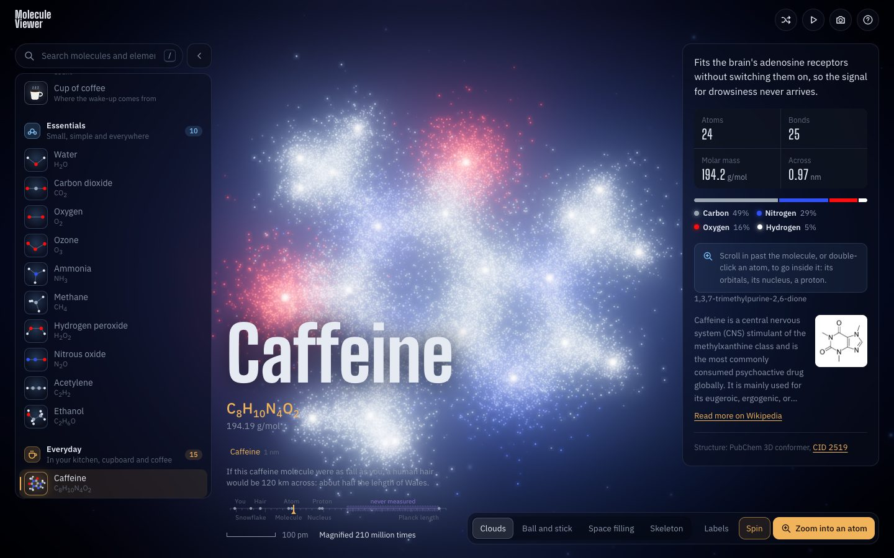
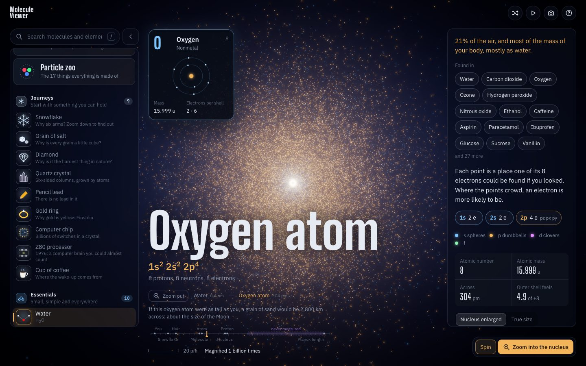
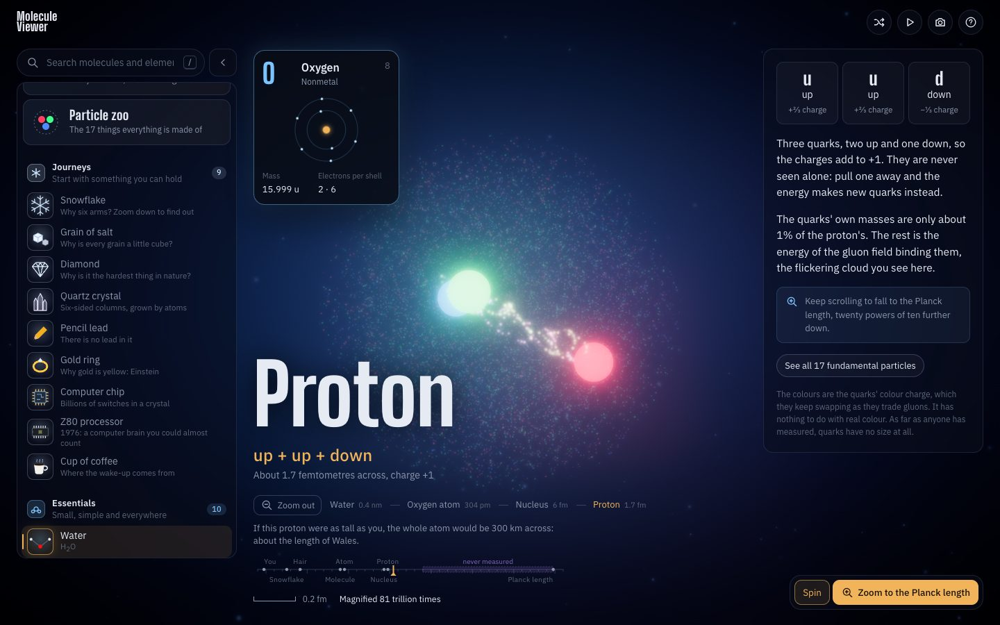
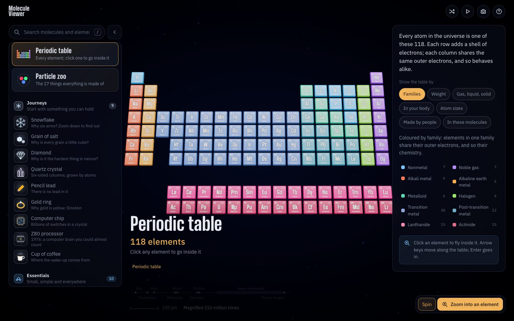
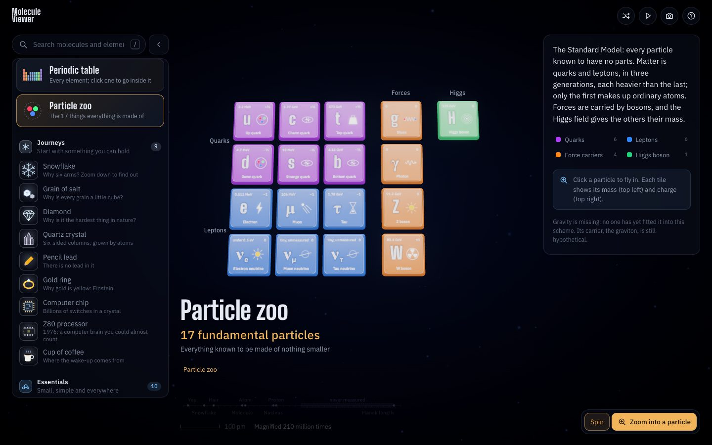
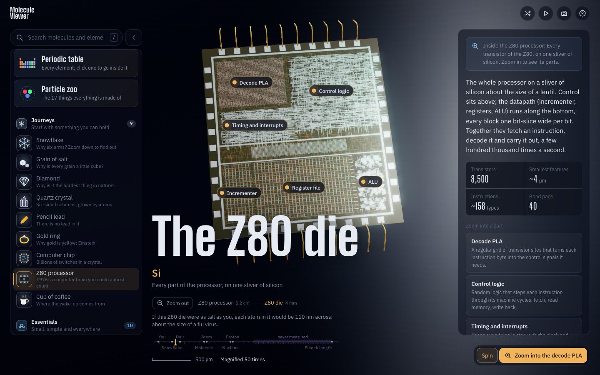

This project was entirely AI generated, using some basic prompts, and conversation with GitHub Copilot, Hugging Face Anychat with Deepseek and Google Gemini. I wrote no code directly at all. I know little about elements or chemistry so this may be inaccurate - which was an interesting part of the experiment. There are many possible refinements and optimisation. 

To see the code live go here: https://danamini.github.io/molecule-viewer/ 



Everything after this is AI generated...


# Molecule Viewer

Everything is made of something smaller. Start with something you could hold, a snowflake, a grain of
salt, a Z80 processor, and zoom in: its material, molecules, atoms, the nucleus, a proton's quarks, and
finally the Planck length. Thirty-two powers of ten, with the scale kept human all the way down.

| Molecules as electron clouds | An atom's orbitals | A proton's quarks |
| --- | --- | --- |
|  |  |  |

| The periodic table | The particle zoo | Inside a Z80 |
| --- | --- | --- |
|  |  |  |

## What's in it

- **A story to follow.** The landing page lays out five chapters along the scale (things you can hold,
  molecules, elements, particles, the Planck length). *Start the journey* is a captioned descent from a
  snowflake to the bottom of physics that shows why snowflakes have six arms.
- **Journeys from real things.** A snowflake, a grain of salt, a diamond, a quartz crystal on its rock,
  pencil lead, a gold ring, a modern computer chip, a Zilog Z80 and a cup of coffee, lit as studio
  objects. Composite things carry labelled hotspots: zoom into the chip's bond wire and land in gold, the
  coffee's spoon and land in iron.
- **The Z80, all the way down.** The 40-pin package, then the die with its blocks labelled (decode PLA,
  control, timing, incrementer, register file, ALU), then one NMOS transistor cut open and switching,
  then each of its materials.
- **Real molecules.** 53 molecules with PubChem's computed 3D coordinates and 10 crystal lattices built
  from measured cell parameters, plus live search across PubChem's 100+ million compounds. Draw them as
  shimmering electron clouds, ball and stick, space filling or skeleton; click atoms to measure distances
  and angles.
- **Below the molecule.** Atoms show their real electron configuration as orbitals (hydrogen-like,
  scaled by Slater's rules), the nucleus its true proton and neutron counts (enlarged, or at true size),
  nucleons their quarks, electrons their field, and the Planck length Wheeler's quantum foam, labelled
  as a guess.
- **Scale you can feel.** A live magnification, a ruler from your height to 10⁻³⁵ m, and comparisons
  ("if this nucleus were as tall as you, the atom would be 100 km across").
- **The periodic table, reimagined.** 118 tiles that spiral in, and views that reshape it: weight
  (tiles rise as bars), gas/liquid/solid, what is in your body, atom sizes (tiles scale to each atom's
  radius), the library's molecules, elements made by people. Hover for an animated atom card; click to
  fly inside. Each element links to the molecules it is in and where you meet it.
- **The particle zoo.** The Standard Model's 17 particles, each with mass, charge, spin and an icon.
- **Surprise me and Tour** jump or tour at random through everything. Keyboard throughout (`?` lists the
  keys), phone layout, picture export, and every place has a shareable address
  (`#caffeine`, `#element-Fe`, `#particle-mu`, `#thing-z80`, `#cid-2519`).

## Run it

A static site with no build step. Serve the folder and open it:

```
python3 -m http.server 8000
```

then go to http://localhost:8000. (Opening `index.html` straight from disk will not work: browsers block
ES modules over `file://`.)

## Test it

```
npm install
npx playwright install chromium
npm test
```

`tests/smoke.mjs` serves the site and drives it in Chromium: the landing page, every library entry in
every style, the full zoom to the Planck length, the periodic table's views and hover, every journey and
every composite part, the Z80 chain, the guided journey, search (including live PubChem, skipped when
offline), random, tour, and the phone layout. Any console error fails the run.

## How it's built

See [docs/architecture.md](docs/architecture.md) for the code layout, how levels chain together, and how
to add a molecule, a journey or a part.

## Data

- Structures: [PubChem](https://pubchem.ncbi.nlm.nih.gov) 3D conformers, fetched by
  `tools/build_library.py` (`npm run build:library`), which writes `molecules.js`. Buckminsterfullerene
  has no PubChem conformer, so its geometry is computed there, as are the crystal lattices.
- Crystals: α-quartz (Levien, Prewitt and Weidner 1980), diamond, rock salt, graphene, gold, copper,
  aluminium, iron (α), silicon and ice Ih, from standard lattice parameters; ice's hydrogens follow the
  Bernal–Fowler ice rules.
- Elements: Jmol CPK colours; Cordero et al. (2008) covalent and Bondi (1964) / Alvarez (2013) van der
  Waals radii. Particles: Particle Data Group masses, rounded.
- Z80 die: the datapath layout follows Ken Shirriff's reverse engineering of Z80 die photos
  ([righto.com](https://www.righto.com/2014/10/how-z80s-registers-are-implemented-down.html)); the
  control area is drawn schematically. The journey objects and the transistor are drawn, not photographed.
- Summaries: Wikipedia's REST API, fetched live. Rendering: [three.js](https://threejs.org) r170.

## License

This project is licensed under the MIT License. See the LICENSE file for details.
